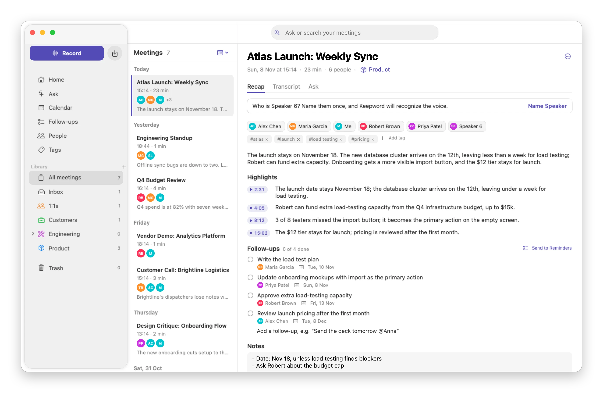
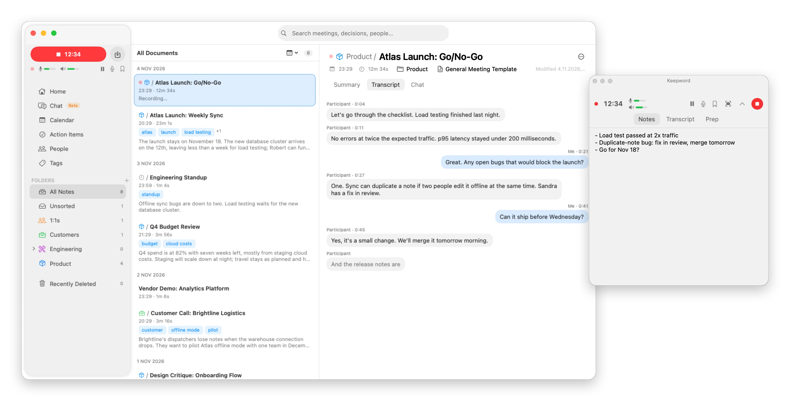
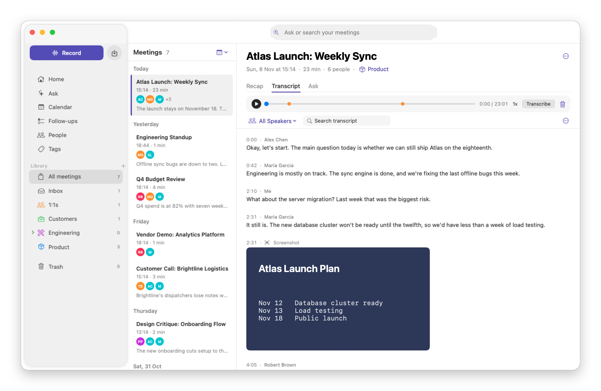
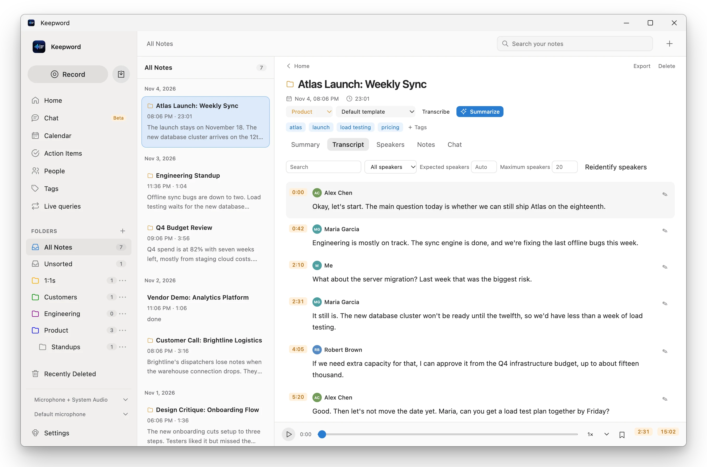
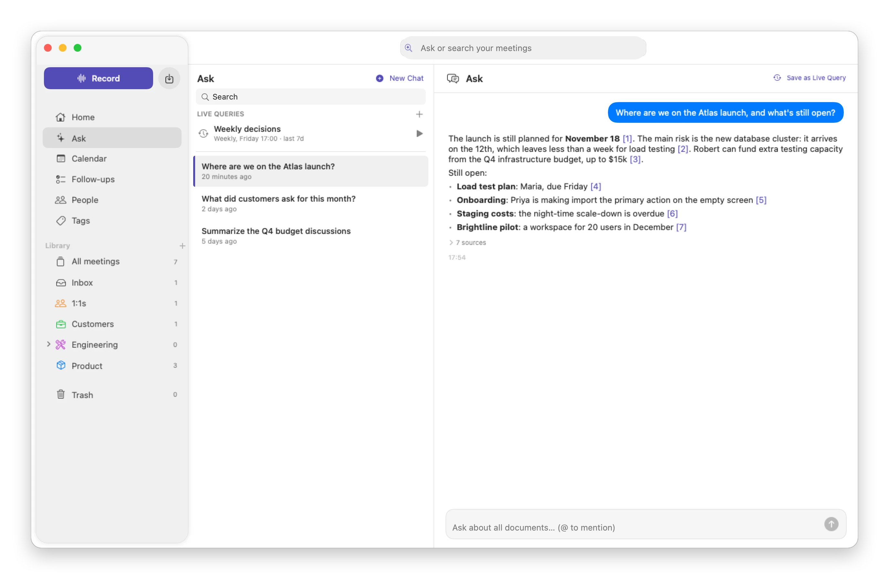
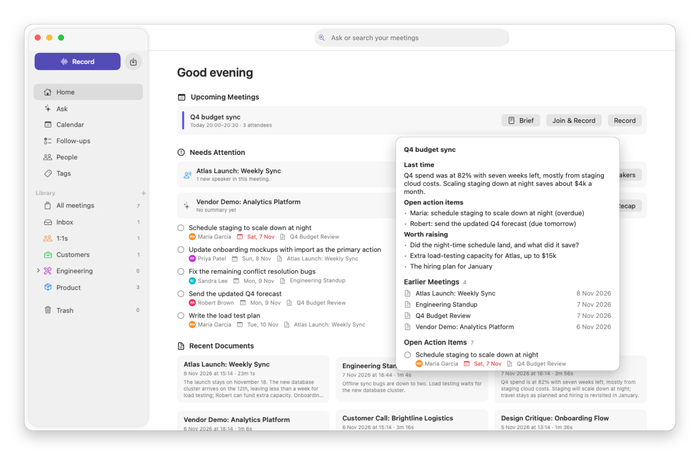
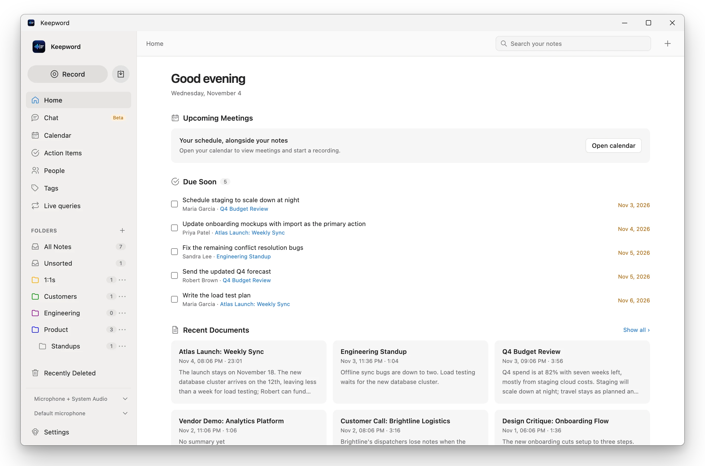
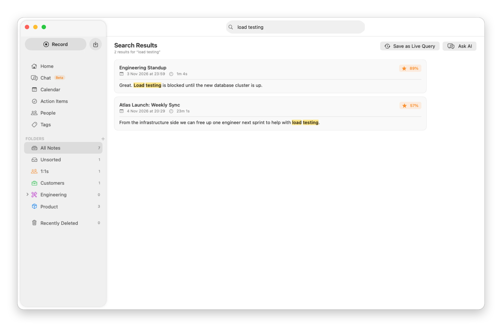
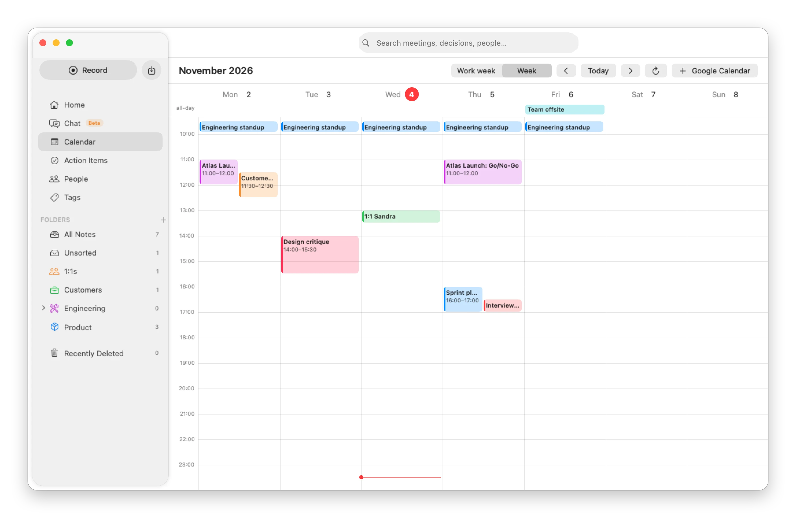
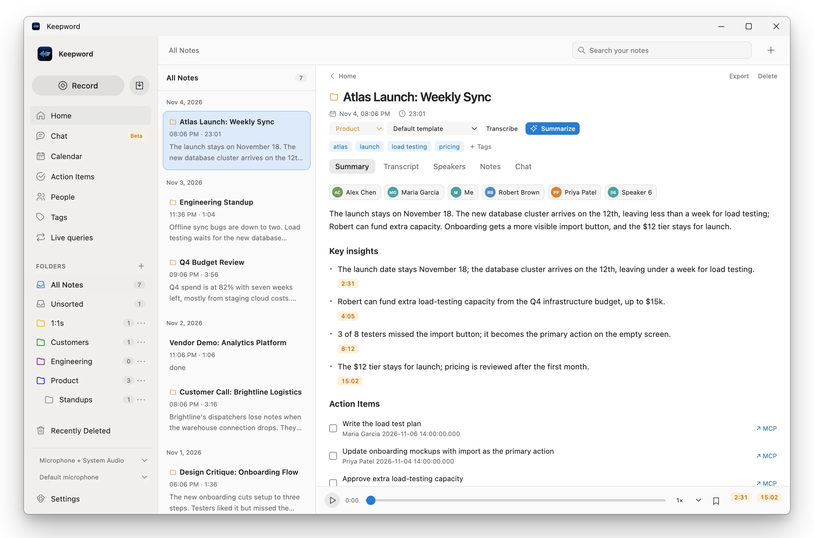

<h1 align="center">Keepword</h1>

<p align="center">
  Meeting notes that stay on your computer.<br>
  Records calls without a bot, transcribes and tells speakers apart on-device, writes the summary,<br>
  and answers questions across all your meetings.
</p>

<p align="center">
  macOS 15+ (Apple Silicon) · Windows 10/11 (x64) · MIT license
</p>

<picture>
  <source media="(prefers-color-scheme: dark)" srcset="docs/screenshots/summary-dark.webp">
  
</picture>

Keepword records the microphone and the system audio as two separate tracks, so it works with Zoom, Meet, Teams, Slack or a phone call in the browser, and nobody has to admit a bot into the call. After the call it transcribes the audio, works out who said what, and writes a summary with key decisions and action items. Insights and chat answers link to the moment in the recording they come from.

All of that can run on your machine: speech recognition, speaker identification, search and the language model. Cloud services are optional and you choose them per feature.

There are two native apps, for macOS and for Windows. They share the database schema, the prompts and the layout. The Mac app came first; the Windows app is a newer port, and [the table below](#macos-and-windows) lists what it doesn't have yet.

## Recording

Press Record (⌘R on a Mac), or let Keepword notice that a call has started and offer to record it. While you talk, a live transcript fills in, and a small floating window keeps the timer, pause, mute, bookmarks and screenshots above the call. Notes you type there end up in the meeting.

<picture>
  <source media="(prefers-color-scheme: dark)" srcset="docs/screenshots/recording-dark.webp">
  
</picture>

A recording interrupted by a crash is recovered and processed on the next launch. On a Mac, if AirPods connect or disconnect mid-call, recording carries on with the new device and both tracks stay in sync.

## Transcript and speakers

Speakers are identified on-device and remembered by voice: name someone once and Keepword recognizes them in later meetings. The transcript plays back in sync with the audio, with your bookmarks and screenshots taken during the call placed at the moment they happened. You can filter by speaker, search, edit blocks and reassign them to someone else. The Mac app can also split a block in two; the Windows app can identify the speakers again with a different expected or maximum number of people, keeping the text.

<table>
  <tr>
    <th width="50%">macOS</th>
    <th width="50%">Windows</th>
  </tr>
  <tr>
    <td>
      <picture>
        <source media="(prefers-color-scheme: dark)" srcset="docs/screenshots/transcript-dark.webp">
        
      </picture>
    </td>
    <td>
      <picture>
        <source media="(prefers-color-scheme: dark)" srcset="docs/screenshots/windows-transcript-dark.webp">
        
      </picture>
    </td>
  </tr>
</table>

## Chat across meetings

Chat answers from your own meetings and cites its sources: each `[n]` opens the transcript at the moment it refers to. Mention a person (`@Maria`), a tag or a meeting title to narrow the question, or ask about a time range ("the first ten minutes"). A question you ask every week can become a live query that reruns on a schedule.

<picture>
  <source media="(prefers-color-scheme: dark)" srcset="docs/screenshots/chat-dark.webp">
  
</picture>

## Home

Home lists the action items due soon and the latest meetings. On a Mac it also shows today's and tomorrow's meetings from your calendar. For a meeting with history, **Brief** collects the earlier meetings with the same title or the same people, the action items they left open, and on request writes a short brief: what was decided last time, who owes what, what to raise. Needs Attention also flags recent meetings with unnamed speakers, failed processing or no summary yet.

<table>
  <tr>
    <th width="50%">macOS</th>
    <th width="50%">Windows</th>
  </tr>
  <tr>
    <td>
      <picture>
        <source media="(prefers-color-scheme: dark)" srcset="docs/screenshots/home-dark.webp">
        
      </picture>
    </td>
    <td>
      <picture>
        <source media="(prefers-color-scheme: dark)" srcset="docs/screenshots/windows-home-dark.webp">
        
      </picture>
    </td>
  </tr>
</table>

## Search and calendar

Search combines keyword matching with on-device semantic search, so a question in one language finds a passage in another. The calendar shows your week, and a meeting can be recorded straight from its event. The Mac app reads the calendars in macOS and Google Calendar; the Windows app reads ICS feeds, such as the secret iCal address of a Google Calendar, and refreshes them every hour.

<table>
  <tr>
    <td width="50%">
      <picture>
        <source media="(prefers-color-scheme: dark)" srcset="docs/screenshots/search-dark.webp">
        
      </picture>
    </td>
    <td width="50%">
      <picture>
        <source media="(prefers-color-scheme: dark)" srcset="docs/screenshots/calendar-dark.webp">
        
      </picture>
    </td>
  </tr>
</table>

## Tasks in Jira, Linear and other services

Action items can become tasks in Jira, Linear, Notion, Asana or Miro. Each has a ready-made setup and connects through a browser sign-in. Keepword fills in the title, a description with a link back to the meeting and, where the service has one, the due date; it remembers the project or board you picked. Any other service whose MCP server can create tasks or cards works too. On a Mac, action items can also go to Apple Reminders, and you can type them in plain text: "Send the deck tomorrow @Anna" gets a due date and an owner.

## Also included

- Summary templates (nine built in, plus your own), chosen per meeting or per folder.
- Folders, tags, people with their meeting history, and a trash that keeps meetings for 30 days.
- Import of existing audio and video files (on a Mac also by drag and drop).
- Markdown export, including automatic export into a folder such as an Obsidian vault.
- A local MCP server, so Claude and other MCP clients can search your meetings and read transcripts. It listens on `127.0.0.1` only and needs a token.
- Transcripts longer than the model's context are summarized in parts.
- English and Russian interface.
- Keepword keeps running in the menu bar on a Mac and in the system tray on Windows.

## macOS and Windows

<picture>
  <source media="(prefers-color-scheme: dark)" srcset="docs/screenshots/windows-summary-dark.webp">
  
</picture>

| | macOS | Windows |
|---|---|---|
| System | macOS 15 or later, Apple Silicon | Windows 10 version 2004 or later, Windows 11; x64 |
| Built with | Swift, SwiftUI | Tauri 2, Rust, React |
| System audio | Core Audio process tap | WASAPI loopback of the output device |
| On-device transcription | Parakeet v3 on the Neural Engine, or Whisper | Parakeet v3 on the CPU |
| Speaker identification | FluidAudio | sherpa-onnx |
| Calendar | macOS calendars, Google Calendar | ICS feeds |
| Action items go to | Apple Reminders and MCP services | MCP services |
| Not there yet | | Whisper, Brief and Needs Attention on Home, plain-text action items, starting an in-person recording from the tray |
| Status | Signed and notarized download | Built from source; needs testing on more hardware and real calls |

The Windows plan and its progress are in [`windows/PLAN.md`](windows/PLAN.md).

## Where your data goes

Everything is stored locally: in `~/Library/Application Support/MeetNotes/` on a Mac and in `%LOCALAPPDATA%\MeetNotes\` on Windows. There is no Keepword server and no account.

| Step | On your machine | Optional cloud |
|---|---|---|
| Transcription | Parakeet (25 languages); on a Mac also Whisper (99 languages) | OpenAI, Groq, Deepgram, any OpenAI-compatible endpoint |
| Speaker identification | Always on-device | |
| Summaries and chat | Built-in Qwen via llama.cpp, Ollama, LM Studio | OpenAI, Anthropic, Gemini, OpenRouter, DeepSeek, or your ChatGPT / Claude subscription through the Codex or Claude Code CLI |
| Search | Built-in multilingual embedding model | An OpenAI-compatible embeddings server |

Models are downloaded on first use, after which a fully local setup works offline. API keys and sign-in tokens are kept in the macOS Keychain or the Windows Credential Manager.

## Install

### macOS

Download `Keepword-0.1.0.dmg` from [Releases](https://github.com/ghaniev/keepword/releases/latest), open it and drag Keepword to Applications. It needs macOS 15 or later on Apple Silicon. The app is signed with a Developer ID and notarized by Apple.

To build it yourself, you need Xcode 26. From a clone of this repository:

```bash
cd macos
./build_app.sh && open Keepword.app
```

On first use macOS asks for microphone and system audio access, and later for Calendar and Reminders if you use them. Pick an AI provider in the welcome screen or in Settings → AI Provider. More in [`macos/README.md`](macos/README.md).

### Windows

There is no Windows download yet, so build it from source. You need Visual Studio Build Tools with the "Desktop development with C++" workload, Rust, Node.js 20 or later and the WebView2 runtime, which Windows 11 already has. Then:

```powershell
cd windows\app
npm ci
npm run tauri dev
```

`windows\scripts\package-release.ps1` builds an unsigned installer. The speech, speaker and search models (about 1.2 GB) and the optional local language model (2.7 GB) download from Settings → Models. More in [`windows/README.md`](windows/README.md).

## Repository

| Folder | What | Stack |
|---|---|---|
| [`macos/`](macos) | The macOS app | Swift, SwiftUI, FluidAudio (Parakeet, diarization), WhisperKit, llama.cpp, GRDB |
| [`windows/`](windows) | The Windows app | Tauri 2, Rust, React, ONNX Runtime, sherpa-onnx, llama.cpp |
| [`docs/screenshots/`](docs/screenshots) | The images on this page | |

A change to the database schema goes into both apps, see [CONTRIBUTING.md](CONTRIBUTING.md). The screenshots show a made-up demo library; `macos/screenshots.sh` renders the Mac ones again from the current code.

## Contributing

Bug reports, fixes and translations are welcome. Start with [CONTRIBUTING.md](CONTRIBUTING.md); security issues go through [SECURITY.md](SECURITY.md).

## License

MIT, see [LICENSE](LICENSE). Third-party components are listed in [`macos/THIRD_PARTY.md`](macos/THIRD_PARTY.md) and [`windows/THIRD_PARTY.md`](windows/THIRD_PARTY.md). Speech, speaker and language models are downloaded on request and come with their own licenses.
